# Retro Lyrics Display

**Spotify lyrics, word by word, on a 16x2 LCD, with an infrared remote.**

A Node.js app syncs whatever I'm playing on Spotify to an Arduino-driven LCD. A Raspberry Pi Pico turns the starter kit's IR remote into a USB media controller with **instant pause** and a **sleep mode**. This is my first electronics project, built from zero hardware experience.


<p align="center">
  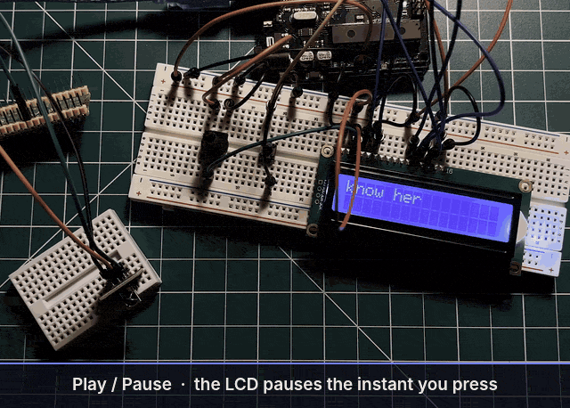
</p>
<p align="center"><sub>Play/pause on the remote: the LCD freezes the moment I press, then picks the lyrics back up in sync.</sub></p>

## Features

- **Word-by-word lyrics** synced to Spotify. It uses real per-word timing when the song has it and estimates it otherwise.
- **IR remote**: play/pause, next, previous, and volume. The Pico shows up on the PC as a USB keyboard pressing media keys.
- **Instant pause**: the Pico tells the sync app directly, so the LCD reacts before Spotify even reports the pause.
- **Sleep mode**: the power button blanks the screen and pauses the music. Press it again to wake both back up.
- **Live timing nudge**: the ← / → keys shift the lyrics earlier or later while it runs.
- **One-click launcher**: a desktop shortcut with a custom pixel-art icon.

<table>
  <tr>
    <td width="50%" align="center">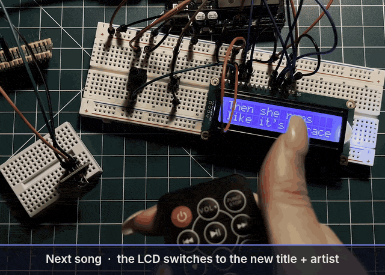<br><sub><b>Next song:</b> the LCD follows every skip</sub></td>
    <td width="50%" align="center">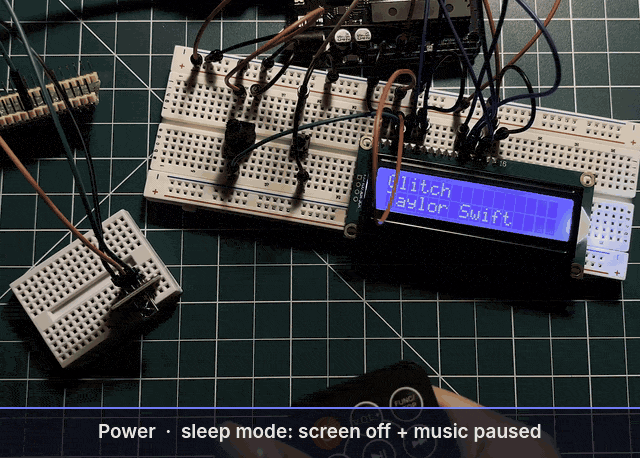<br><sub><b>Sleep mode:</b> screen off + music paused</sub></td>
  </tr>
</table>

## How it works

```
  ELEGOO IR remote
        │  infrared flashes (NEC codes)
        ▼
  Raspberry Pi Pico ──── USB keyboard ────► media keys ──► Spotify desktop app
  (CircuitPython)   └─── USB serial ──┐     "REMOTE:PLAY_PAUSE" / "REMOTE:POWER"
                                      ▼
  Spotify Web API ◄───────────► Node.js sync app (PC) ◄────── LRCLIB (timed lyrics)
  song + position,                    │
  pause / play                        │  USB serial: "top row|bottom row"
                                      ▼
                              Arduino Uno ──► 16x2 LCD
```

### Lyrics: sync app → Uno
1. Every **0.5 seconds**, the app asks the **Spotify Web API** what's playing and how far into the song it is. The answer is already a little old when it arrives, so the app adds **half the network round trip**.
2. When the song changes, it downloads the song's **timed lyrics** from **LRCLIB**. It prefers the version whose length matches the song (within 2 seconds).
3. **Word timing:** it uses real per-word timestamps when LRCLIB has them (its newer "lyricsfile" format). Otherwise, each line's time is spread across its words, longer words get more time, and the words finish at 85% of the line, because singers usually finish before the next line starts.
4. Every **50 ms**, it estimates the current position (last reading + time since), finds the words sung so far, wraps them to 16 characters per row, and sends `top|bottom` to the Uno. Long lines flip through **pages**.
5. The Uno just listens: it reads each `top|bottom` message and prints it on the LCD.

### Remote: Pico → PC
6. The **IR receiver** filters out everything except the remote's 38 kHz flicker and turns it into clean on/off pulses. The Pico times those pulses and decodes them into 4 bytes: `(0, 255, button, check)`. The first two identify the remote, the third is the button, and the fourth is an error check (button + check = 255).
7. A **lookup table** maps each button to a **media key**, and the Pico sends it over USB like a keyboard would (**USB HID**). Windows passes it to Spotify.
8. For **play/pause** and **power**, the Pico also prints a line (`REMOTE:PLAY_PAUSE`, `REMOTE:POWER`) over its USB serial port. The sync app listens on that port and updates the LCD **immediately**. For the next 1.5 seconds it trusts the remote over Spotify, which is slow to catch up.
9. **Sleep mode** blanks the LCD and pauses Spotify through the Web API, but only if music is playing. Waking resumes the music only if sleep mode was what paused it.

<p align="center">
  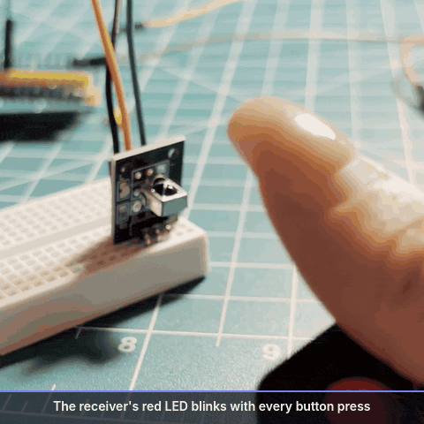
  <br><sub>The receiver's LED blinks with every button press, a handy wiring check before writing any code.</sub>
</p>

## Remote buttons

| Button | Code (3rd byte) | What it does |
|---|---|---|
| ⏯ Play / Pause | `2` | Play or pause. The LCD reacts instantly. |
| ⏭ Next | `194` | Next song |
| ⏮ Previous | `34` | Back to the start of the song (press twice for the previous song) |
| 🔊 VOL+ | `98` | Windows volume up (hold to keep going) |
| 🔉 VOL− | `168` | Windows volume down (hold to keep going) |
| 🔴 Power | `162` | Sleep mode on / off |

Codes from other remotes are ignored: the first two bytes must be `0, 255`.

## Versions

| Version | What it does | Code |
|---|---|---|
| **v1** | Lyrics typed into the code, timed with `millis()`, started by a button | `firmware/lyrics_timed` |
| **v2** | Auto-syncs with Spotify + LRCLIB, one line at a time | `firmware/lcd_serial_listener` + `sync-app/` |
| **v2.1** | Word-by-word lyrics, network-delay fix, live timing nudge, length-matched lyrics | `sync-app/` |
| **v2.2** | IR remote on a Pico: media keys, instant pause, sleep mode, 4x faster Spotify polling | `firmware/ir_remote` + `sync-app/` |
| **v3** *(next)* | Standalone: ESP32-S3 with Wi-Fi, 40x2 LCD, clear acrylic case, no PC needed | planned |

<details>
<summary>v2 demo (line by line, before word-by-word)</summary>
<br>

</details>

## Hardware

| Part | Notes |
|---|---|
| Arduino Uno R3 (ELEGOO) | From the ELEGOO UNO R3 Super Starter Kit |
| LCD1602 (16x2 character LCD) | HD44780-compatible, 4-bit mode |
| 10k potentiometer | LCD contrast |
| Push button | v1 start button |
| Raspberry Pi Pico | Runs CircuitPython; acts as a USB keyboard |
| IR receiver module + remote | From the ELEGOO kit. "1838" receiver; pins labeled **G R Y**; the remote sends NEC codes |
| Breadboard + mini breadboard + jumper wires | No soldering. Female-to-male wires for the Pico |

## Wiring

### LCD → Uno

| LCD pin | Name | Connects to |
|---|---|---|
| 1 | VSS | GND |
| 2 | VDD | 5V |
| 3 | V0 | Potentiometer middle leg (contrast) |
| 4 | RS | Uno pin 7 |
| 5 | RW | GND (write-only) |
| 6 | E | Uno pin 8 |
| 11–14 | D4–D7 | Uno pins 9, 10, 11, 12 |
| 15 | A | 5V (backlight +) |
| 16 | K | GND (backlight −) |

- **Potentiometer:** outer legs to 5V and GND, middle leg to LCD V0
- **Button (v1):** one leg to Uno pin 2, the diagonal leg to GND (uses the Uno's built-in pull-up)

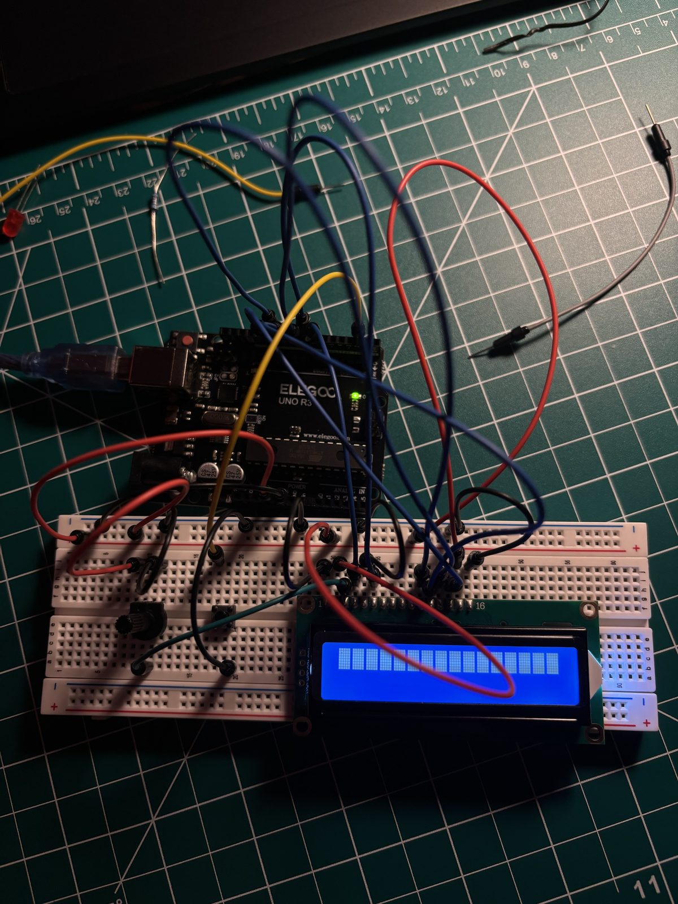

### IR receiver → Pico

| Receiver pin | Pico pin | Physical pin | Wire |
|---|---|---|---|
| **G** (ground) | GND | 38 | Black |
| **R** (power) | 3V3(OUT) | 36 | Orange |
| **Y** (signal) | GP22 | 29 | Green |

- The receiver's pins and the Pico's pins are both **male**, so they meet in a **mini breadboard**. The receiver stands up in one row, and female-to-male wires run from the Pico into the same columns.
- ⚠️ Power the receiver from **3V3**, never **VBUS** (5V). The Pico's pins only handle 3.3V.

<table>
  <tr>
    <td width="33%">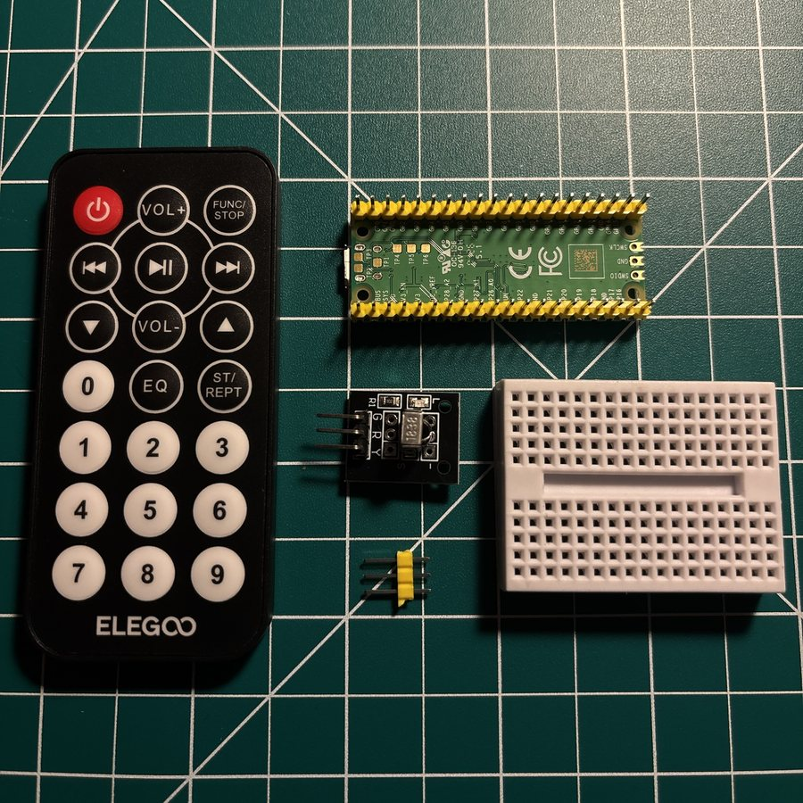<br><sub><b>The parts:</b> remote, Pico, IR receiver, mini breadboard</sub></td>
    <td width="33%">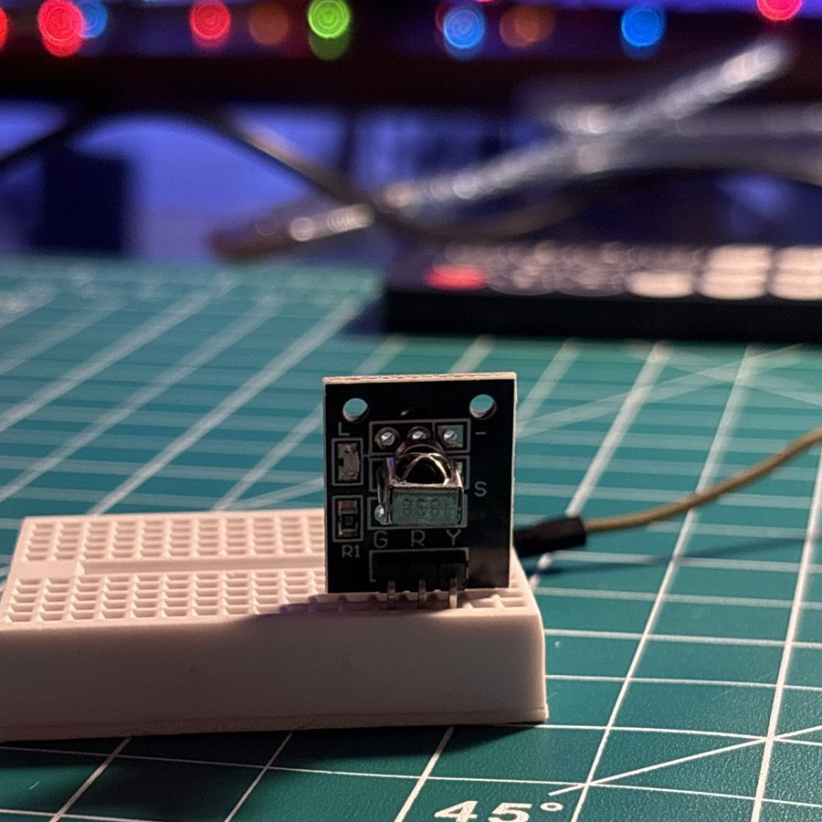<br><sub><b>Receiver:</b> standing in the mini breadboard, facing the room</sub></td>
    <td width="33%">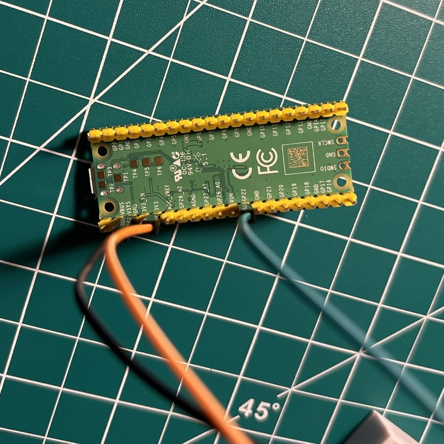<br><sub><b>Pico:</b> GND, 3V3, and GP22</sub></td>
  </tr>
</table>

## Project structure

```
retro-lyrics-display/
├── firmware/
│   ├── lyrics_timed/                 v1: timed lyrics + start button (Uno)
│   ├── lcd_serial_listener/          v2+: shows text sent from the PC (Uno)
│   └── ir_remote/code.py             v2.2: IR remote → media keys + instant messages (Pico, CircuitPython)
├── sync-app/                         Node.js app that runs on the PC
│   ├── src/
│   │   ├── sync.mjs                  main sync program (lyrics, remote, sleep mode)
│   │   ├── auth.mjs                  one-time Spotify login (OAuth with PKCE)
│   │   └── serial-test.mjs           sends one test message to the Uno
│   ├── assets/app-icon.ico           desktop shortcut icon
│   ├── start.bat                     double-click launcher (Windows)
│   └── package.json
└── docs/images/                      photos + GIFs for this README
```

## Run it yourself

### 1. Lyric display

**You need:** Node.js 20.6+, Spotify Premium, and an Arduino Uno wired as above.

1. Upload `firmware/lcd_serial_listener` to the Uno with the Arduino IDE.
2. Create an app at the [Spotify Developer Dashboard](https://developer.spotify.com/dashboard):
   - Redirect URI: `http://127.0.0.1:8888/callback`
   - API: Web API
   - Add your Spotify account under **User Management**
3. In `sync-app/`:
   ```
   npm install
   ```
   Create a `.env` file containing:
   ```
   SPOTIFY_CLIENT_ID=your_client_id
   ```
4. Log in once. This opens your browser and asks permission to read **and control** playback (control is used by sleep mode):
   ```
   npm run login
   ```
5. Close the Arduino Serial Monitor, play a song in Spotify, and run:
   ```
   npm start
   ```
   On Windows you can also double-click `start.bat`.

### 2. IR remote (optional)

1. Hold the Pico's **BOOTSEL** button while plugging it in. When the **RPI-RP2** drive appears, drag on the **CircuitPython 10.x** `.uf2` for the [Raspberry Pi Pico](https://circuitpython.org/board/raspberry_pi_pico/). A **CIRCUITPY** drive appears.
2. From the [CircuitPython 10.x library bundle](https://circuitpython.org/libraries), copy `adafruit_hid/` and `adafruit_irremote.mpy` into `CIRCUITPY/lib`.
3. Copy `firmware/ir_remote/code.py` onto `CIRCUITPY`. It runs automatically whenever the Pico is plugged in.
4. Wire the receiver as in [IR receiver → Pico](#ir-receiver--pico).
5. Set `PICO_PORT` in `src/sync.mjs` to the Pico's COM port. Close any program using that port (like Thonny), since only one program can use a port at a time.
6. Run `npm start`. The terminal should say **"Remote connected on COM4: instant pause is on."**

Without the Pico, the display works exactly the same, just without instant pause and sleep mode.

### Settings (top of `src/sync.mjs`)

| Setting | Default | What it does |
|---|---|---|
| `PORT_PATH` | `'COM3'` | The Uno's port |
| `PICO_PORT` | `'COM4'` | The remote Pico's port |
| `POLL_MS` | `500` | How often to ask Spotify where the song is |
| `TICK_MS` | `50` | How often the LCD updates |
| `LEAD_MS` | `250` | Shifts lyrics earlier (bigger) or later. Nudge live with ← / →, then save it in `.env` |
| `MAX_LINE_MS` | `6000` | Longest time one line's words are spread across |
| `WORD_SPREAD` | `0.85` | Estimated words finish at this fraction of the line |
| `REMOTE_TRUST_MS` | `1500` | After a remote press, how long to trust the remote over Spotify |

`.env`, `tokens.json`, and `node_modules` are in `.gitignore`, so no credentials are committed. Lyrics are fetched at runtime and are not stored in this repo.

## Build log

### Session 1: Nov 11, 2026
- Uploaded my first sketch (Blink), changed the timing, and built my first LED + resistor circuit
- Calculated the LED resistor with Ohm's law, then verified it with a multimeter: LED 2.00 V + resistor 2.49 V ≈ 4.49 V total, about 11.3 mA
- Added button input (`INPUT_PULLUP`), wired and powered the LCD, and printed "hello"
- **v1:** timed lyrics with a start button using `millis()` and a state flag
- **v2:** Uno listener sketch → Node.js serial test → Spotify login (PKCE) → auto-sync with LRCLIB lyrics → page-flipping for long lines

### Session 2: Nov 14, 2026 (v2.1)
- **Word by word:** real word timestamps from LRCLIB's lyricsfile format when available, otherwise estimated from each line's length
- **Timing fixes:** adds half the network round trip, live ← / → nudge saved as `LEAD_MS`, and prefers lyrics whose length matches the song

### Session 3: Nov 14, 2026, late night (v2.2)
- Installed **CircuitPython** on the Pico and blinked its LED to prove the setup
- Wired the IR receiver (it lit up on the first button press) and read the code for every remote button
- Built the **lookup table → media keys** firmware, so the remote controls Spotify
- Pause took ~3 seconds to reach the LCD, so I polled Spotify 4x faster, then made it **instant**: the Pico messages the sync app directly
- Added **sleep mode** on the power button, using Spotify's playback-control permission

## Build photos

<table>
  <tr>
    <td width="33%">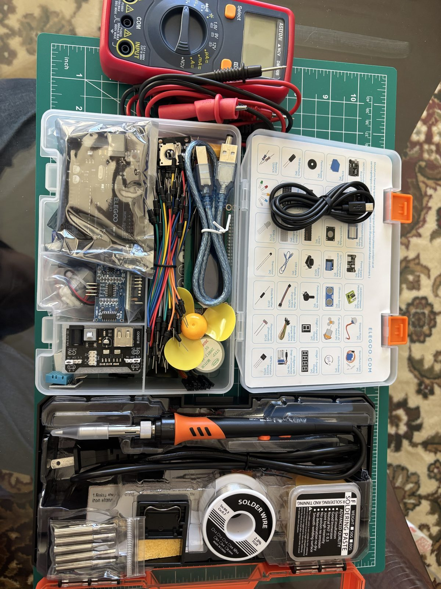<br><sub><b>Day 1:</b> starter kit, multimeter, and soldering kit</sub></td>
    <td width="33%">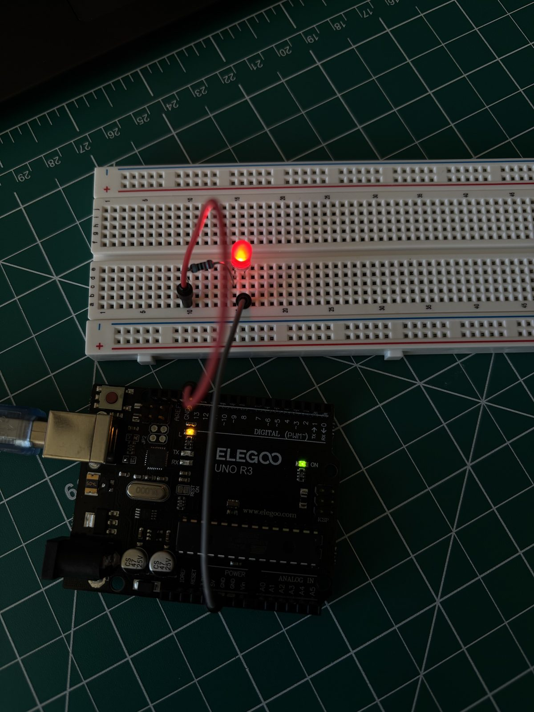<br><sub><b>First circuit:</b> LED + 220 Ω resistor</sub></td>
    <td width="33%">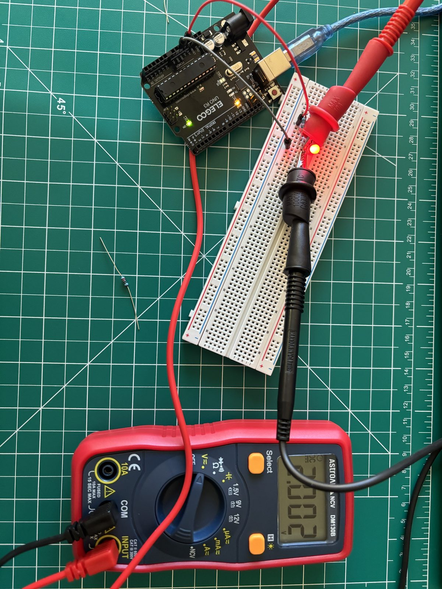<br><sub><b>Checking the math:</b> 2.00 V across the LED</sub></td>
  </tr>
  <tr>
    <td width="33%"><br><sub><b>LCD powered:</b> the row of boxes means power + contrast work</sub></td>
    <td width="33%">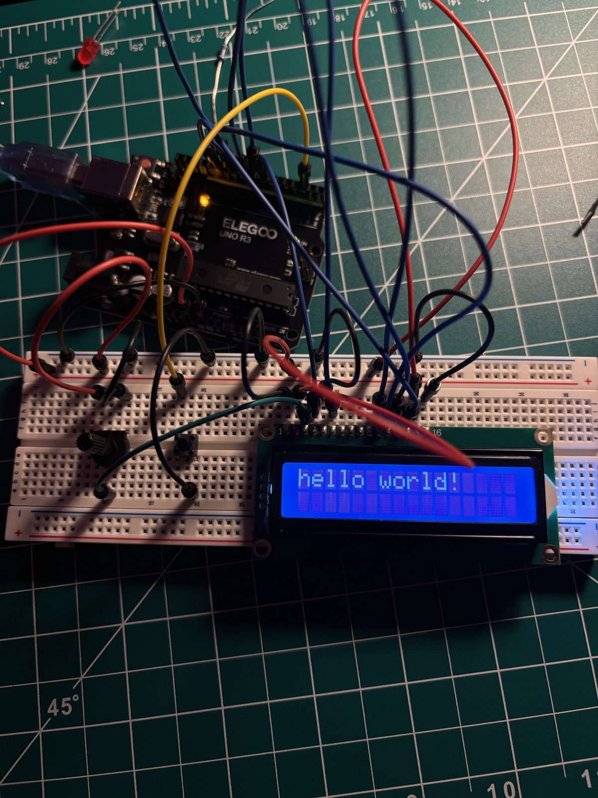<br><sub><b>First words:</b> LiquidCrystal "hello world"</sub></td>
    <td width="33%"><br><sub><b>Desktop launcher:</b> custom app icon</sub></td>
  </tr>
</table>

## Problems I hit (and how I fixed them)

| Problem | Cause | Fix |
|---|---|---|
| Button code did nothing | Used `pinMode()` where `digitalWrite()` was needed | `pinMode` sets a pin's job; `digitalWrite` sets its value |
| LED never lit | Its ground wire had been moved, so the circuit loop was open; the button wire was in pin 0 | Traced every loop back to GND; read printed pin labels instead of counting holes |
| Multimeter showed "OL" on a 1 kΩ resistor | Meter was in continuity mode | Switched to resistance mode |
| Short-circuit test kept beeping | Both test wires were in the same power-rail row | "Test the tester": one wire on each rail row |
| Potentiometer placement would short 5V to GND | Two legs shared one breadboard column | Every leg in its own column |
| Long lyric lines got cut off | The LCD only fits 32 characters | Split lines into pages, timed by text length |
| Lyrics appeared a whole line at a time | LRCLIB usually only has a start time per line | Spread each line's time across its words; use real word times when available |
| Timing felt a little late | Spotify's answer is ~0.1–0.3 s old on arrival; speakers add delay | Add half the network round trip, plus a live nudge saved as `LEAD_MS` |
| One song was way off | A different version of the song's lyrics | Prefer lyrics whose length matches the song |
| Desktop icon couldn't be changed | The desktop item was the `.bat` itself | Made a real shortcut (PowerShell `WScript.Shell`) |
| Launcher window closed instantly | A `.bat` calling `npm` needs `call` | `call npm start` |
| Jumper wires kept slipping off the IR receiver | Bent-sideways pins + loose wire sockets | Stood the receiver in a mini breadboard; Pico wires meet it in the same columns |
| Thonny said "Unable to connect to COM4" | Unplugging the Pico to wire it dropped Thonny's connection | Pressed **STOP** to reconnect |
| LCD kept showing lyrics ~3 s after pausing | The app checked Spotify every 2 s and kept its clock running in between | Poll every 0.5 s, then instant pause: the Pico tells the app directly |
| Waking from sleep flashed "- Paused -" for a second | A Spotify answer already on its way overwrote the remote's newer state (a race condition) | Ignore Spotify answers that arrive within 1.5 s of a remote press |

## What I learned
- Circuits, Ohm's law, and measuring voltage, resistance, and continuity with a multimeter
- Breadboard layout, power rails, pull-up inputs, and driving an HD44780 LCD in 4-bit mode
- Arduino C++: `millis()` vs `delay()`, state flags, structs, and serial communication
- Node.js: serial ports, OAuth 2.0 with PKCE and permission scopes, polling a REST API, parsing LRC timestamps, and keeping secrets out of Git
- Estimating between known points (word timing) and correcting for network delay
- CircuitPython on a Raspberry Pi Pico, 3.3V vs 5V logic, and **USB HID** (a board acting as a keyboard)
- How IR remotes work: a 38 kHz carrier, NEC codes, and decoding pulse timings
- Two devices talking to one program over separate serial ports, and fixing a **race condition** between them

## Next
- **v3, standalone:** ESP32-S3 with built-in Wi-Fi talks to Spotify and LRCLIB itself, on a 40x2 LCD in a clear acrylic case
- **Real lights-out sleep:** switch the LCD backlight through an NPN transistor so sleep mode turns off the glow too
- Map the remote's ▲ / ▼ buttons to the live timing nudge

## Credits
- [Spotify Web API](https://developer.spotify.com/documentation/web-api) for playback position and control
- [LRCLIB](https://lrclib.net) for synced lyrics
- Arduino `LiquidCrystal` library
- [CircuitPython](https://circuitpython.org) with Adafruit's `adafruit_hid` and `adafruit_irremote` libraries
