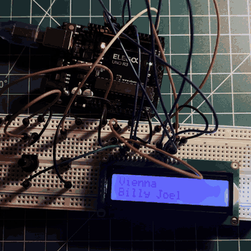

# Retro Lyrics Display

A 16x2 LCD that shows **synced lyrics for whatever is playing on Spotify**, built with an Arduino Uno and a small Node.js program. I built this as my first electronics project, starting from zero hardware experience.


<!-- Add your demo GIF or a photo at docs/images/demo.gif -->

## How it works

```
Spotify (song + position) ──► Node.js program on my PC ◄── LRCLIB (timed lyrics)
                                       │
                                  USB serial  ("top row|bottom row")
                                       ▼
                               Arduino Uno ──► 16x2 LCD
```

1. Every 2 seconds, the PC program asks the **Spotify Web API** what's playing and how many milliseconds into the song it is.
2. When the song changes, it downloads the song's **timed lyrics** (LRC format) from **LRCLIB**.
3. Every 0.1 seconds, it estimates the current position (last reading + time since), finds the matching lyric line, word-wraps it to 16 characters per row, and sends it to the Uno over USB.
4. Long lines are split into **pages** that flip while the line is sung. Pages with more text stay up longer.
5. The Uno just listens: it reads `top|bottom` messages and prints them on the LCD.

## Versions

| Version | What it does | Code |
|---|---|---|
| **v1** | Lyrics typed into the code, timed with `millis()`, started by a button | `firmware/lyrics_timed` |
| **v2** | Auto-syncs with Spotify, no button, no typing lyrics | `firmware/lcd_serial_listener` + `sync-app/` |

## Hardware

| Part | Notes |
|---|---|
| Arduino Uno R3 (ELEGOO) | From the ELEGOO UNO R3 Super Starter Kit |
| LCD1602 (16x2 character LCD) | HD44780-compatible, 4-bit mode |
| 10k potentiometer | LCD contrast |
| Push button | v1 start button |
| Breadboard + jumper wires | No soldering |

## Wiring

| LCD pin | Name | Connects to |
|---|---|---|
| 1 | VSS | GND |
| 2 | VDD | 5V |
| 3 | V0 | Potentiometer middle leg (contrast) |
| 4 | RS | Uno pin 7 |
| 5 | RW | GND (write-only) |
| 6 | E | Uno pin 8 |
| 11–14 | D4–D7 | Uno pins 9, 10, 11, 12 |
| 15 | A | 5V (backlight +) |
| 16 | K | GND (backlight −) |

- **Potentiometer:** outer legs to 5V and GND, middle leg to LCD V0
- **Button (v1):** one leg to Uno pin 2, the diagonal leg to GND (uses the Uno's built-in pull-up)


## Project structure

```
retro-lyrics-display/
├── firmware/                         code that runs on the Arduino
│   ├── lyrics_timed/                 v1: timed lyrics + start button
│   └── lcd_serial_listener/          v2: shows text sent from the PC
├── sync-app/                         Node.js app that runs on the PC
│   ├── src/
│   │   ├── sync.mjs                  main auto-sync program
│   │   ├── auth.mjs                  one-time Spotify login (OAuth with PKCE)
│   │   └── serial-test.mjs           sends one test message to the Uno
│   ├── assets/app-icon.ico           desktop shortcut icon
│   ├── start.bat                     double-click launcher (Windows)
│   └── package.json
└── docs/images/                      photos for this README
```

## Run it yourself

**You need:** Node.js 20+, Spotify Premium, an Arduino Uno wired as above.

1. Upload `firmware/lcd_serial_listener` to the Uno with the Arduino IDE.
2. Create an app at the [Spotify Developer Dashboard](https://developer.spotify.com/dashboard):
   - Redirect URI: `http://127.0.0.1:8888/callback`
   - API: Web API
   - Add your Spotify account under **User Management**
3. In `sync-app/`:
   ```
   npm install
   ```
   Create a `.env` file containing:
   ```
   SPOTIFY_CLIENT_ID=your_client_id
   ```
4. Log in once (opens your browser):
   ```
   npm run login
   ```
5. Close the Arduino Serial Monitor, play a song in Spotify, and run:
   ```
   npm start
   ```
   On Windows you can also double-click `start.bat`.
6. Settings at the top of `src/sync.mjs`: `PORT_PATH` (your COM port), `LEAD_MS` (shift timing earlier/later), `MAX_LINE_MS` (page-flip speed for long lines).

`.env`, `tokens.json`, and `node_modules` are in `.gitignore`, so no credentials are committed. Lyrics are fetched at runtime and are not stored in this repo.

## Build log

### Session 1: Nov 11, 2026
- Uploaded my first sketch (Blink), changed the timing, and built my first LED + resistor circuit
- Calculated the LED resistor with Ohm's law, then verified it with a multimeter: LED 2.00 V + resistor 2.49 V ≈ 4.49 V total, about 11.3 mA
- Added button input (`INPUT_PULLUP`), wired and powered the LCD, and printed "hello"
- **v1:** timed lyrics with a start button using `millis()` and a state flag
- **v2:** Uno listener sketch → Node.js serial test → Spotify login (PKCE) → auto-sync with LRCLIB lyrics → page-flipping for long lines

## Problems I hit (and how I fixed them)

| Problem | Cause | Fix |
|---|---|---|
| Button code did nothing | Used `pinMode()` where `digitalWrite()` was needed | `pinMode` sets a pin's job; `digitalWrite` sets its value |
| LED never lit | Its ground wire had been moved, so the circuit loop was open; the button wire was in pin 0 | Traced every loop back to GND; read printed pin labels instead of counting holes |
| Multimeter showed "OL" on a 1 kΩ resistor | Meter was in continuity mode | Switched to resistance mode |
| Short-circuit test kept beeping | Both test wires were in the same power-rail row | "Test the tester": one wire on each rail row |
| Potentiometer placement would short 5V to GND | Two legs shared one breadboard column | Every leg in its own column |
| Long lyric lines got cut off | The LCD only fits 32 characters | Split lines into pages, timed by text length |

## What I learned
- Circuits, Ohm's law, and measuring voltage, resistance, and continuity with a multimeter
- Breadboard layout, power rails, pull-up inputs, and driving an HD44780 LCD in 4-bit mode
- Arduino C++: `millis()` vs `delay()`, state flags, structs, and serial communication
- Node.js: serial ports, OAuth 2.0 with PKCE, polling a REST API, parsing LRC timestamps, and keeping secrets out of Git

## Next
- Enclosure with a retro look (and maybe a VFD screen)
- Auto-start when Spotify starts playing

## Credits
- [Spotify Web API](https://developer.spotify.com/documentation/web-api) for playback position
- [LRCLIB](https://lrclib.net) for synced lyrics
- Arduino `LiquidCrystal` library
